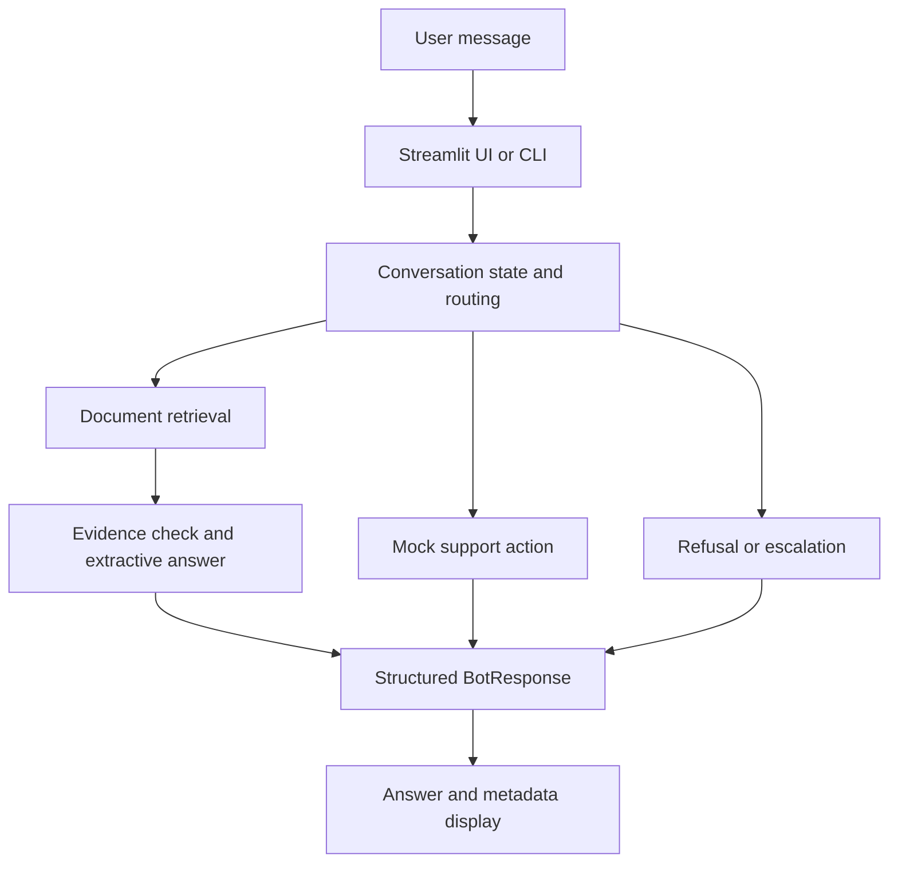

# Commercial Support Chatbot

A Python customer-support chatbot portfolio project exploring document retrieval, evidence-based responses, workflow routing, and conversation memory through a Streamlit interface.

The project addresses a practical support problem: policy questions need traceable answers, account and order requests need structured actions, and some conversations need a human handoff. Its modules explore how to separate those responsibilities and make the system's decisions inspectable.

**Project status:** Development prototype. The repository contains the components described below, but the current snapshot needs integration fixes before the full application and evaluation runner can operate reliably. Tools use mock data, and no verified performance benchmark is published.

## Portfolio Highlights

- Designed a modular support workflow with separate routing, retrieval, response formatting, memory, and UI layers.
- Implemented Markdown document chunking with source identifiers and citation formatting.
- Explored keyword overlap, TF-IDF, embedding search, and weighted hybrid retrieval across successive implementations.
- Defined Pydantic response models with answer text, citations, confidence, escalation status, and optional retrieval details.
- Built a Streamlit chat interface that preserves session history and displays response metadata.
- Developed rule-based support routing and mock interfaces for order lookup, ticket creation, and password reset.
- Added conversation-state extraction for order IDs, email addresses, refund interest, and final-sale status.
- Created a 10-case evaluation dataset and metric scaffolding for retrieval, citations, refusal behavior, and evidence overlap.
- Added console and file logging to inspect routing decisions, retrieval scores, and errors.

## Skills Demonstrated

| Area | Evidence in the repository |
| --- | --- |
| Python application design | Separate modules for orchestration, routing, memory, schemas, response building, and logging |
| Retrieval and NLP | Paragraph chunking, TF-IDF similarity, embedding/FAISS experiments, and hybrid score fusion |
| Structured data modeling | Pydantic `BotResponse` and `ToolCall` models; dataclass-based conversation state |
| Workflow design | Explicit document-answer, tool-call, and escalation routes |
| Frontend integration | Streamlit chat messages, session state, metadata display, and expandable retrieval details |
| Evaluation design | JSONL cases and functions for retrieval hit rate, citation presence, refusal correctness, and token overlap |
| Debugging and observability | Shared logger configuration, retrieval previews, decision summaries, and exception traces |
| LLM experimentation | Separate OpenAI and local Ollama prompt labs with adjustable model, prompt, and temperature |

## Intended Support Workflows

| Request | Intended behavior |
| --- | --- |
| “Are final-sale items refundable?” | Retrieve policy evidence and return an answer with source citations |
| “How long does standard shipping take?” | Find relevant shipping-policy passages |
| “Where is my order 12345?” | Extract the order ID and route to a mock lookup |
| “My item arrived damaged.” | Route to mock support-ticket creation |
| “Reset my password for demo@example.com.” | Extract the email and route to a mock reset action |
| “I want to speak to a human.” | Return an escalation response and set `needs_human` |

These examples describe the intended workflows, not verified transcripts from the current application. Mock tools do not access real orders, create external tickets, send reset emails, or connect a user to an agent.

## Architecture

The intended integrated flow is:



The current code contains two backend approaches: a logging/RAG handler defined in `main.py` and a stateful handler in `obsolete/handler.py`. The latter is imported over the former's name. Consolidating them is required to realize the full flow above.

### Retrieval and evidence

`rag/chunk.py` splits Markdown files into groups of paragraphs and attaches `doc_id`, `chunk_id`, and `text`. `rag/ingest.py` writes those records to JSON.

`rag/retrieve_hybrid.py` defines a retriever that normalizes sparse and dense scores, then combines them using:

```text
hybrid_score = alpha × sparse_score + (1 - alpha) × dense_score
```

The default weighting is equal (`alpha = 0.5`). Sparse and dense implementations currently live under `obsolete/` and require repairs and integration. The hybrid demo uses toy keyword-derived vectors; a separate embedding module references `all-MiniLM-L6-v2`.

`rag/answer.py` builds an extractive answer by joining up to two retrieved chunks. It formats citations as `[doc_id:chunk_id]` and refuses when there are no results or the best score is below `0.30`. Additional ambiguity and evidence-strength helpers exist, but the current answer entry point does not invoke them.

The document-answer path does not call a generative model. OpenAI and Ollama calls are isolated in the prompt-lab scripts.

### Conversation state and transparency

`ConversationState` stores support-specific fields such as order ID, email, issue type, refund interest, final-sale status, and recent history. Streamlit keeps this state between reruns within a session. This is in-memory context, not persistent customer storage.

The UI displays citations, confidence, and the human-handoff flag. It can also render retrieved chunks when supplied by the backend. Confidence values are rules or retrieval-derived scores; they are not calibrated probabilities of correctness.

## Project Structure

```text
commercial_chatbot/
├── app.py                     # Streamlit chat interface and session state
├── main.py                    # CLI, logging/RAG handler, and handler import
├── action_router.py           # Document/tool/escalation routing
├── router.py                  # Basic intent classification
├── guardrails.py              # Keyword-based refusal and escalation rules
├── memory.py                  # Conversation state and context extraction
├── helper.py                  # Order-ID and email extraction
├── schemas.py                 # Pydantic response and tool-call models
├── tools.py                   # Mock order, ticket, and password-reset tools
├── response_builder.py        # Tool-result response formatting
├── logger_config.py           # Console and file logging configuration
├── debug_utils.py             # Retrieval and final-decision logging helpers
├── rag/
│   ├── chunk.py               # Markdown paragraph chunking
│   ├── ingest.py              # Chunk ingestion and JSON export
│   ├── retrieve_hybrid.py     # Sparse/dense score-fusion implementation
│   └── answer.py              # Extractive answers, citations, evidence checks
├── eval/
│   ├── eval_cases.jsonl        # 10 policy and out-of-scope cases
│   └── eval.py                # Evaluation runner and metric scaffolding
├── test/
│   ├── test_step3.py           # Answer-generation smoke-test script
│   ├── prompt_lab.py           # OpenAI prompt experiment CLI
│   ├── prompt_lab_llama.py     # Ollama prompt experiment CLI
│   ├── install_ollama.sh       # Linux-oriented installer script
│   └── chat_log.jsonl          # Saved prompt-lab examples
├── obsolete/
│   ├── main1.py, main2.py      # Earlier CLI/pipeline iterations
│   ├── handler.py             # Stateful handler still imported by main.py
│   ├── prompts.py             # Earlier structured-output prompt
│   ├── retrieve_keyword_overlap.py
│   ├── retrieve_sparse.py     # TF-IDF retrieval
│   ├── retrieve_dense.py      # Embedding-based retrieval prototype
│   ├── retrieve_semantic.py   # FAISS retrieval prototype
│   ├── retrieve_hybrid_demo.py
│   ├── embed.py               # Sentence-transformer embedding helpers
│   ├── vector_store.py        # FAISS and metadata helpers
│   ├── build_index.py         # Index-building prototype
│   └── tool_executor.py       # Mock-tool dispatcher
└── logs/
    └── chatbot.log            # Local runtime log
```

Local environment files, the virtual environment, Python caches, and OS metadata are omitted from this map. Despite its name, `obsolete/` currently contains a runtime dependency and cannot simply be removed.

## Tech Stack

| Purpose | Technologies represented in the code |
| --- | --- |
| Application and UI | Python, Streamlit |
| Data contracts and state | Pydantic v2-style APIs, dataclasses, JSON/JSONL |
| Retrieval experiments | scikit-learn, NumPy, Sentence Transformers, FAISS |
| Optional prompt labs | OpenAI Python SDK, python-dotenv, Requests, Ollama |
| Observability | Python logging |

## Local Setup

The repository does not currently include a dependency manifest. The commands below prepare a development environment based on imports; they do not resolve the code issues listed under **Current Limitations**. Python 3.12 is a reasonable starting point because an archived demo uses f-string syntax unsupported by older Python versions.

From the `commercial_chatbot` directory:

```bash
python3.12 -m venv .venv
source .venv/bin/activate
python -m pip install streamlit "pydantic>=2,<3"
```

Install additional packages only for the relevant experiments:

```bash
# Retrieval experiments
python -m pip install numpy scikit-learn sentence-transformers faiss-cpu

# Optional model prompt labs
python -m pip install openai python-dotenv requests
```

The application entry points are:

```bash
streamlit run app.py
python main.py
```

Treat these as development entry points; a working end-to-end demo has not been verified for this snapshot.

The ingestion script expects Markdown source documents in `knowledge_base/` and writes `data/chunk_metadata.json`:

```bash
python rag/ingest.py
```

Neither `knowledge_base/` nor a populated `data/` directory is included in the reviewed folder. Supply source documents before ingestion; the script does not create policy content or a vector index by itself.

The independent prompt labs can be launched with:

```bash
python test/prompt_lab.py
python test/prompt_lab_llama.py
```

The OpenAI lab expects `OPENAI_API_KEY` in the environment or a local `.env` file. The Ollama lab expects a local server and the configured `llama3.2:3b` model. Use synthetic support examples: the labs record prompts and responses in `chat_log.jsonl` relative to the working directory. Keep credentials and private conversation logs out of version control.

## Evaluation

`eval/eval_cases.jsonl` contains **10 cases**: seven policy questions covering refunds, shipping, and warranty, and three out-of-scope questions.

The evaluation scaffold defines:

- **Retrieval hit:** whether the expected source document appears in retrieved results.
- **Citation presence:** whether a response contains at least one citation.
- **Refusal correctness:** whether the response's refusal status matches the case label.
- **Evidence overlap:** the fraction of answer tokens also found in retrieved text.

Evidence overlap is a lexical heuristic, not proof of factual correctness. Citation presence does not establish that every claim is supported. The current runner also treats cases without an expected document as retrieval hits, so its aggregate needs refinement before it can represent retrieval quality.

The runner needs syntax, import, and metric-aggregation fixes before use. No generated evaluation report is present, so this README reports no accuracy or success-rate claims.

## Current Limitations

- **Integration:** `main.py` replaces its locally defined handler with `obsolete.handler.handle_message`, leaving the intended RAG/action flow disconnected from the exported handler.
- **Execution blockers:** Python 3.12 syntax validation identifies errors in `tools.py` and `eval/eval.py`.
- **Retrieval wiring:** the main retrieval call does not construct a retriever instance and uses an incompatible keyword argument; the hybrid implementation contains a `dict.key()` typo. Several archived modules reference files at outdated paths.
- **Data and identifiers:** knowledge-base documents and index artifacts are absent. Per-document chunk IDs must be made unique across documents, or merged using `(doc_id, chunk_id)`, to prevent hybrid retrieval collisions.
- **Routing consistency:** the action router's order-ID pattern is malformed, and guardrail rules can conflict with the intended password-reset workflow.
- **Mock actions:** support actions use fixed sample data and have no external service integration.
- **Evaluation coverage:** the small dataset does not validate multi-turn behavior, tool execution, or the complete UI-to-backend workflow.

## Next Steps

1. Consolidate the backend entry point, fix syntax/import errors, and connect routing, retrieval, memory, and tool dispatch.
2. Add a small, versioned support knowledge base and reproducible indexing instructions.
3. Add a dependency manifest and focused automated tests for routing, retrieval, memory, and response contracts.
4. Repair the evaluation runner, separate applicable metric denominators, and publish actual results with failure analysis.
5. Capture screenshots and a short walkthrough from a verified working demo.
6. Explore reranking, confidence calibration, and authenticated integrations with real support systems.

This project is a portfolio prototype for demonstrating support-system design and development. Real customer use would require additional validation, access controls, privacy handling, and operational integration.
